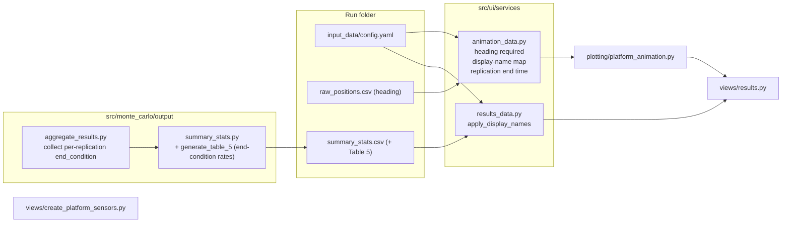

# PLAN: Animation and Results Enhancements (rev. 2)

**Status:** Completed (all features implemented, verified with tests, typing, and linting)
**Proposed branch:** `feature/animation-results-enhancements`

---

## 0. Environment Constraints

| Constraint | Impact on implementation |
|---|---|
| `requires-python >= 3.9` **and** `.python-version = 3.9` | No `match`, no runtime `X \| Y`, **no PEP 695 `type X = ...` statement (needs 3.12)**. See the open question in §6. |
| GEMINI §4 (new): no deprecated type-hint syntax | `typing.Dict` / `typing.List` / `typing.Tuple` are deprecated aliases (PEP 585). Use built-in `dict` / `list` / `tuple` in every file we touch. |
| GEMINI §4 (new): clean signatures | Complex types get named aliases; restricted values use `Literal`; structured data uses `TypedDict`. |
| `numpy>=2.0.2`, `pandas>=2.3.3`, `plotly>=6.9.0`, `streamlit>=1.50.0` | **No new dependencies.** |
| `pytest --cov=src/monte_carlo --cov=src/schemas --cov-fail-under=80` | F4 now touches **core** (`summary_stats.py`, `aggregate_results.py`), so its tests count towards the 80 % gate. |
| Streamlit 1.50 | Replace the deprecated `use_container_width=True` with `width="stretch"` in `results.py`. |

### Proposed type aliases (exact syntax depends on Q-A in §6)

```python
PlatformId = str
PlatformNameMap = dict[PlatformId, str]               # runtime id -> display name
PlatformAnimationMap = dict[PlatformId, PlatformAnimationData]
EndConditionType = Literal["time_limit", "target_escaped", "barrier_crossed",
                           "world_crossed", "detection", "counter_detection",
                           "blue_team_detection", "red_team_detection"]
```

---

## 1. High-Level Approach

Most of the work is in the UI boundary layer. **F4 is now a core change**, because the end-condition rates are saved as Table 5 in `summary_stats.csv`. New logic goes into small, pure, typed helpers that pytest can cover. Streamlit views only wire those helpers up.



---

## 2. Feature Breakdown

### F1: Heading passed through `animation_data.py` (decision: no backward compatibility)

- Add `"heading"` to `REQUIRED_POSITION_COLUMNS`. A CSV without it raises `ValueError` through the existing missing-columns check. **No fallback** for old runs.
- `heading` becomes part of the numeric columns (`errors="raise"`), normalised with `% 360.0`.
- `build_platforms` reads `row.heading` directly (drop the `hasattr` guard). `PlatformPosition["heading"]` becomes `float`.
- `platform_animation._platform_heading_deg` / `_position_at_time` use the supplied heading. The waypoint-direction fallback is removed.
- **Investigation step:** confirm that the heading on a waypoint-arrival event belongs to the *new* leg. If it lags, fix it at the boundary.

### F2: Slider max = replication's last recorded time and a time-limit text box

- `SimulationTiming` gets `end_time_sec: float`. `time_limit_sec` is kept for display.
- New helper `compute_replication_end_sec(platforms: PlatformAnimationMap) -> float` returns the max `timestamp_sec` across all platforms.
- `build_animation` builds frames over `[0, end_time_sec]`:
  - If `end_time_sec / world_timestep_sec <= MAX_ANIMATION_FRAMES` (450), use **one frame per world timestep**.
  - Otherwise, sample `MAX_ANIMATION_FRAMES` frames evenly (`linspace`). Detection timestamps and the end time are always added as frames.
  - The 450-frame cap stays for browser performance. Because frames now cover only the actual replication, short replications get full timestep resolution.
- `results.py`: above the chart, two read-only fields side by side: a disabled `st.text_input("Simulation time limit (user input)", value="X.XX min", disabled=True)`, and the replication duration for comparison.
- `animate.py` (CLI) and `load_replication_animation_data` are updated to set `end_time_sec`.

### F3: Sensor `x_values` header renamed for generic sensors

- New helper `x_axis_column(sensor_type: SensorType) -> str` returns the **chosen header (see Q-B)** for `"generic"` and `"x_values"` otherwise.
- **Manual editor:** the DataFrame column is renamed to that header, and the caption and help text say "range from the sensor in metres".
- **CSV import:** generic sensors expect that header (with the `pod` column). The existing auto-map of the first two columns still works.
- **Sensor Overview table:** the column shows the same header.
- **Persistence:** the header is mapped back to the schema key `x_values` just before `SensorFactory.create_sensor`, so YAML, schema and the detection pipeline are unchanged.

### F4: End-condition rates as Table 5 in `summary_stats.csv` (core)

- **Source of truth:** `SimulationResult["end_condition"]` (one per replication), collected in `aggregate_and_output_results`. We use this instead of Table 4, so replications where no platform has sensors (no detection rows) still count towards the total.
- `summary_stats.generate_table_5(end_conditions: list[EndConditionType]) -> pd.DataFrame` returns the columns `end_condition | count | proportion`:
  - **Every** literal is listed **separately** (including `detection`, `blue_team_detection` and `red_team_detection`), with zero-count rows included.
  - An empty input gives every row as `0` / `0.0` and never divides by zero.
- `write_summary_stats_csv(..., end_conditions=...)` writes `# 5. End Condition Rates Across Replications`.
- `results.py`: a KPI row for the three detection types, Time Limit Reached and Target Escaped (proportion and count), plus the full Table 5 underneath. It is read through the existing `load_summary_stats_tables` (the section regex already supports `# 5.`).

### F5: Platform display names in the animation and results (decision: names are unique)

- `build_display_name_map(config_data: ConfigData) -> PlatformNameMap` zips `assign_platform_ids` with `platform.display_name`. **No disambiguation**, because the Streamlit platform form already blocks duplicate names. A defensive `logging.warning` is logged if duplicates are found anyway (for example, a hand-edited YAML).
- `PlatformAnimationData` gets `display_name: str`. Internal keys stay `platform_id`.
- `build_animation`: trace names, the legend, the detection hover, the detection note and the jump buttons use `display_name`.
- `results_data.apply_display_names(df, name_map, columns)` maps `detecting_platform_id` / `target_platform_id` in Tables 1 and 4 before charting, so the heatmap axes, selectboxes and histogram titles show names.
- Callers updated: `results.py`, `animate.py`.

---

## 3. Task Checklist

- [x] **0.** Branch `feature/animation-results-enhancements`; `uv sync --dev`; baseline `uv run pytest`
- [x] **T.0** Add type aliases (syntax per Q-A); replace `typing.Dict/List/Tuple` in touched files
- [x] **F1.1** `heading` required, numeric and normalised in `load_positions`
- [x] **F1.2** Remove the fallback logic in `build_platforms` / `platform_animation.py`
- [x] **F1.3** Check the heading on waypoint-arrival events
- [x] **F2.1** `end_time_sec` and `compute_replication_end_sec`
- [x] **F2.2** Frame generation over `[0, end_time_sec]` with the 450 cap
- [x] **F2.3** Time-limit text box and duration in `results.py`; update `animate.py`
- [x] **F3.1** `x_axis_column` helper; manual editor, CSV import and overview headers
- [x] **F3.2** Map back to `x_values` before `SensorFactory`
- [x] **F4.1** `generate_table_5` and the `write_summary_stats_csv` signature
- [x] **F4.2** Collect end conditions in `aggregate_and_output_results`
- [x] **F4.3** KPI row and Table 5 view in `render_analytics_tab`
- [x] **F5.1** `build_display_name_map` and `display_name` in `PlatformAnimationData`
- [x] **F5.2** Animation labels; `apply_display_names` in the results tabs
- [x] **H.1** `use_container_width` → `width="stretch"`
- [x] **V.1** `uv run ruff check`, `uv run ty check`, `uv run pytest` (exit code 0, coverage ≥ 80 %)
- [x] **V.2** Generate a fresh run, then a manual Streamlit smoke test
- [ ] **C.1** Commit per feature following `.gitmessage`

---

## 4. Testing Strategy

Files: `tests/ui/test_animation_data.py` (new), `tests/ui/test_platform_animation.py` (extend), `tests/ui/test_results_data.py` (new), `tests/ui/test_create_platform_sensors.py` (new), `tests/monte_carlo/.../test_summary_stats.py` (extend, core).

| Feature | Happy path | Bad path | Extreme path |
|---|---|---|---|
| **F1 Heading** | Headings 0° then 90° flow into records; sensor arcs rotate between frames | CSV without `heading` → `ValueError` naming the column; non-numeric heading → `ValueError` | `360`, `-90`, `720` → `0`, `270`, `0`; static platform (vector `[0,0]`) → `0°`; single-row replication |
| **F2 End time** | End 300 s, limit 3600 s → last slider label `"5.00"`; frame step == world timestep | Empty `platforms` → `ValueError` | End `0.0` → single frame; end/timestep > 450 → exactly ≤ 450 regular frames and detection frames, last == end; detection exactly at end time included |
| **F3 Header** | Generic → chosen header; payload sent to `SensorFactory` contains `x_values` | Non-generic → `"x_values"`; CSV missing `pod` → existing error message | Generic CSV with legacy `x_values` header → auto-mapped (warning shown); empty table |
| **F4 Table 5** | `[detection×6, time_limit×3, target_escaped×1]` → 0.6 / 0.3 / 0.1, sum 1.0, all 8 rows present | Unknown end-condition string → `ValueError`; `None` entries are rejected | Empty list → all zeros, no division error; all reps one outcome → 1.0 with the rest 0.0; 100 000 reps (vectorised); round-trip through `load_summary_stats_tables` |
| **F5 Names** | `{"Blue_1": "Alpha", "Red_1": "Bravo"}`; legend and traces show names; heatmap axes mapped | Unmapped id in `apply_display_names` → original id kept | Duplicate names in YAML → warning logged (`caplog`); unicode / long names; platform with no sensors |

**Fix loop:** a failing test is re-run in isolation (`uv run pytest <file>::<test>`) until exit code `0`, then the full suite runs again.

---

## 5. Resolved Decisions (from user feedback)

| # | Decision |
|---|---|
| 1 | Platform display names are unique, so they are used directly with no suffix. |
| 2 | For generic sensors the `x_values` header is renamed (manual table, CSV import, overview). The internal schema key is unchanged. |
| 3 | Each end condition (including the three detection types) is shown **separately** and saved as **Table 5** in `summary_stats.csv`. |
| 4 | Slider max = last recorded time in the replication; frames are adjusted (450 cap kept). The user time limit is shown in a read-only text box. |
| 5 | Old runs are not supported: `heading` is required, with no fallback. |

---

## 6. Open Questions (blocking)

- **Q-A: Python version vs the new type-alias rule.** `GEMINI.md` now asks for `type MyAlias = ...` (PEP 695), which needs **Python ≥ 3.12**. The project is pinned to **3.9** (`pyproject.toml` and `.python-version`). Options:
  1. Bump to Python 3.12+ (`requires-python`, `.python-version`, `uv sync`). That is a project-wide change.
  2. Stay on 3.9 and use `TypeAlias` annotations (`PlatformNameMap: TypeAlias = dict[str, str]`) with `TypeAlias` from `typing_extensions`, which must be added as an explicit dependency.
  3. Stay on 3.9 and use plain assignments (`PlatformNameMap = dict[str, str]`). No new dependency.
- **Q-B: Header name.** `distance_m` or `range_m` (pick one), and should the CSV import also accept the other as an alias?
